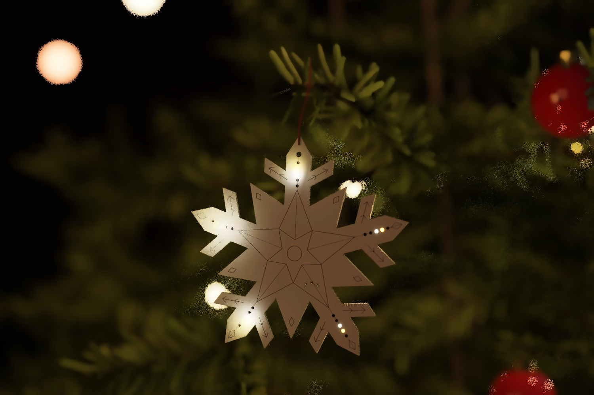
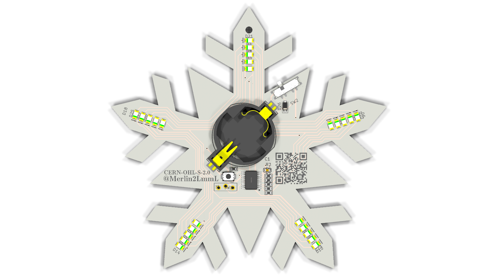
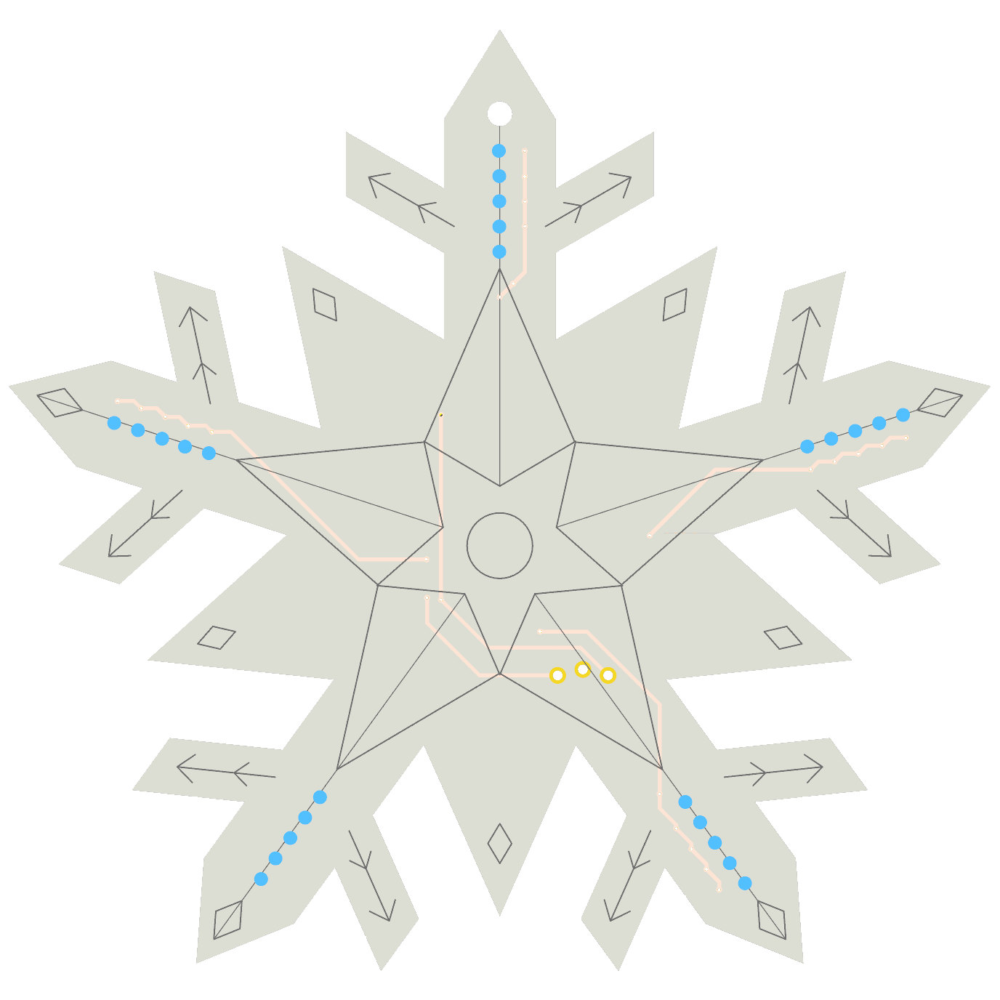

# LEDStars – a snowflake PCB Christmas ornament

**License:** CERN-OHL-S-2.0 · **Author:** Merlin2LmmL

*The ornament hanging on a fir branch, seen from its back. Only the white and yellow LEDs are lit; the light shines through the windows in the board. Photorealistic Blender render, see [`render/`](render/).*

A battery-powered Christmas-tree ornament that *is* its own circuit board: a 5-armed snowflake with 25 LEDs
(5 arms × 5 colours: red, yellow, white, blue, green), a tiny RISC-V microcontroller and a CR2032 coin cell.
Roughly ten of them are meant as gifts, ordered as economic PCBA from JLCPCB.

| Front (parts) | Back (LED windows + silkscreen art) |
|---|---|
|  |  |

## The design in short

- **MCU:** WCH CH32V003F4P6 (TSSOP-20, 48 MHz RISC-V)
- **LEDs:** 25 × 1206 *reverse-mount* LEDs (XL-3216), sitting on the front and shining **through** the board, so the
  light comes out of the back as small glowing windows (each LED footprint has a 1.4 mm non-plated window)
- **Matrix:** 5 arms × 5 colours, multiplexed so the 25 LEDs need far fewer pins than LEDs; per-colour series resistors (22–330 Ω)
  compensate for the different forward voltages of red/yellow/white/blue/green
- **Power:** CR2032 in an SMD holder + 100 nF decoupling
- **Programming:** three bare SWIO pads (`J1`, 3-pad footprint, no header), meant to be programmed with a WCH-LinkE-style SWIO programmer touching the pads, which saves a connector from the BOM
- **Mechanics:** hang hole at the top arm, outline about 99 × 95 mm (JLCPCB limit: 100 × 100 mm)
- **Status:** hardware design only. No firmware is in this repo yet and no board has been ordered or tested yet.

## How it got here – the iterations

I kept the earlier states on purpose so the thinking process is visible.

### 1. First idea: a star with an ATtiny404
The very first schematic used an ATtiny404 and a plain 5-pointed star ([`docs/LEDStars_ATtiny404_old.pdf`](docs/LEDStars_ATtiny404_old.pdf)).
Two star outlines were sketched ([`classic`](docs/star_outline_classic.pdf) and [`chunky`](docs/star_outline_chunky.pdf)).

### 2. Switch to the CH32V003F4P6
The ATtiny404 was swapped for the CH32V003F4P6, a small RISC-V MCU that is still enough for a multiplexed 5×5 matrix
([`docs/LEDStars_CH32V003F4P6_new.pdf`](docs/LEDStars_CH32V003F4P6_new.pdf)). The schematic was regenerated
around it (5 colours × 5 arms, one LED of every colour per arm).

### 3. Front-lit 0805 LEDs → back-lit 1206 reverse-mount LEDs
First version: ordinary 0805 LEDs that shine straight up from the front
([`LEDStars_frontlit_0805.kicad_pcb`](LEDStars_frontlit_0805.kicad_pcb), [pdf](docs/LEDStars_frontlit_0805_pcb.pdf)).
Then I found that JLCPCB stocks **reverse-mount** 1206 LEDs for every colour I need. With a small window in the board
the light shines through the PCB, so the front stays clean and the board looks like a lit glass ornament
([`LEDStars_backlit_1206.kicad_pcb`](LEDStars_backlit_1206.kicad_pcb), [pdf](docs/LEDStars_backlit_1206_pcb.pdf)).
A footprint with 3D model (`lib/LEDStars.3dshapes`) was made for it. I also tried a 3D model for the programming
header and dropped it again, since the header is not part of the BOM.

### 4. From star to snowflake – many attempts
The board outline took by far the most iterations, because a snowflake is easy to get *almost* right:

1. **Plain star.** Works electrically but looks like a generic star, not a snowflake.
2. **Snowflake with thin arms and bar-shaped branches.** Looked brittle, and the branches looked like blocky
   rectangles stuck on.
3. **Thicker arms, tapered round-ended branches, rounded corners (an "oak leaf").** Sturdier, but the rounded
   blobs made it read as a leaf or an acorn rather than ice.
4. **Final: sharp and spiky.** A real 5-pointed star as the hub, five pointed arms growing from the star's inner
   corners (armpits), and one pair of angled, spiky branches per arm. Branch edges run parallel to the star's
   edges, so the hub and the branches echo each other. All edges are straight with sharp corners, and the
   outline is generated by script from a handful of parameters (arm width, branch angle/length, star radius).

The LED pads stay at least 2 mm from the edge and there is 3 mm of material around the hang hole. After each outline change the routing was redone by hand;
the final board has 0 unconnected items and 0 DRC errors.

### 5. Back silkscreen decoration
The back has few traces, so it carries the decoration: a vein with small feather barbs along every branch, a
chevron at the end of each one, small diamonds at the arm tips and the star points, and a star-and-ring
motif in the hub. All pieces were checked against pads, vias and the board edge and are drawn at the JLCPCB
minimum line width of 0.15 mm.

### 6. Licensing
The design is released under the **CERN-OHL-S-2.0** (strongly reciprocal open hardware license). The license name
is printed on the front silkscreen above my handle and is in the schematic title block.

## Photorealistic render

The hero image above is a Cycles render made from the KiCad board itself (exported with `kicad-cli pcb export glb`).
The white and yellow LEDs are emissive, the other colours stay dark, and the tree is built from the CC0 *Fir Sapling*
scans by [Poly Haven](https://polyhaven.com/a/fir_sapling). The whole scene is generated by a script, so it can be
re-rendered or re-lit at any time (about 20 minutes on 6 CPU cores for the final image).

| File | What |
|---|---|
| [`render/LEDStar_christmas_tree_render.png`](render/LEDStar_christmas_tree_render.png) | final image, 1500 × 1000 |
| [`render/LEDStar_christmas.blend`](render/LEDStar_christmas.blend) | Blender 4.0+ scene (textures packed): `Numpad 0`, viewport shading *Rendered* |
| [`render/build_scene.py`](render/build_scene.py) | builds the scene from the board export |
| [`render/README.md`](render/README.md) | rebuild instructions and credits |

## Repository layout

| Path | What |
|---|---|
| `LEDStars.kicad_pro/.kicad_sch/.kicad_pcb` | current KiCad 10 project |
| `LEDStars.kicad_pcb` | the final snowflake board |
| `LEDStars_frontlit_0805.kicad_pcb`, `LEDStars_backlit_1206.kicad_pcb` | earlier board states (see iterations) |
| `lib/` | project symbol, footprint and 3D-model libraries |
| `LEDStar.step` | exported 3D model of the board |
| `docs/` | PDFs and previews of each iteration, renders used in this README |
| `render/` | photorealistic Christmas render: image, Blender scene and the scripts that generate it |

## Building it

1. Open `LEDStars.kicad_pro` in KiCad 10.
2. Generate the JLCPCB files (gerbers, BOM, positions) with the *Fabrication Toolkit* plugin. It writes `production/`,
   which is not tracked in git. The LCSC part numbers are stored in the schematic fields.
3. Check the LED rotation in the JLCPCB 3D/placement preview. Reverse-mount parts are the usual source of
   rotation surprises.

## License

[CERN-OHL-S-2.0](LICENSE). If you build on this design, share your changes under the same license.
