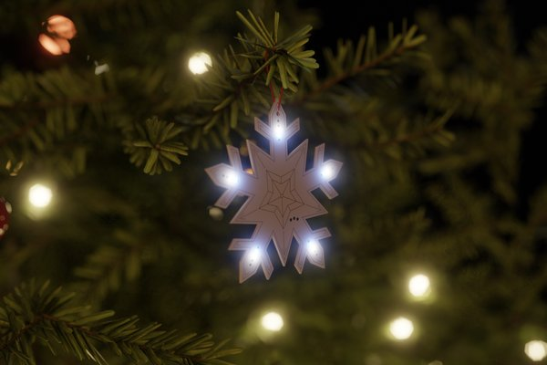
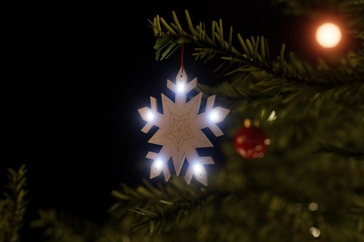
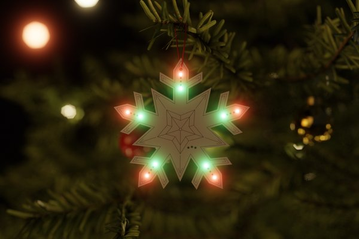
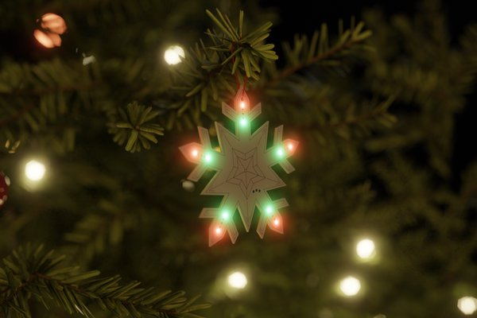

# LEDStars

A snowflake-shaped Christmas ornament that is its own circuit board. It hangs on a tree branch, has 25 LEDs and runs
on a coin cell. I'm making about ten of them as Christmas presents for my family.

License: CERN-OHL-S-2.0 · Author: Merlin2LmmL

*A Blender render of the ornament hanging from a fir twig. You're looking at the back of the board, where the light comes out. More colours and angles are in the [gallery](#gallery).*

## What it is

Five arms with five LEDs each (red, yellow, white, blue and green), a CH32V003 microcontroller in the middle and a CR2032
holder. The LEDs are reverse-mount parts: they sit on the front of the board and shine through a small hole in the PCB,
so from the back you only see glowing dots. The battery, chip and everything else stay on the side that faces the tree.

- **Microcontroller:** WCH CH32V003F4P6, a tiny 48 MHz RISC-V chip in a TSSOP-20.
- **LEDs:** 25 XL-3216 reverse-mount LEDs (1206). The chip lights one arm at a time and cycles through them quickly, so 25 LEDs don't need 25 pins. Each colour has its own resistor because the colours need different currents.
- **Power:** a CR2032 in an SMD holder, with a 100 nF capacitor next to the chip.
- **Controls:** a button to change the lighting mode and a three-position slide switch for on, off and clock.
- **Programming:** three bare pads for SWIO (`J1`). There is no header, you just hold jumper wires on the pads while flashing with a WCH-LinkE.
- **Size:** about 99 × 95 mm, just under JLCPCB's 100 × 100 mm limit, with a hang hole in the top arm.

It's still only a design. No board has been ordered yet and there's no firmware in this repo.

## Gallery

Open a colour set and click any picture for the full-size image (2400 × 1600). Every set has a front, a left and a right view.

<b>White + yellow</b>

<i>front · left · right</i>

<b>White + blue</b>

<i>front · left · right</i>

<b>Red + green</b>

<i>front · left · right</i>

### How the renders are made

The board comes straight from the KiCad file (`kicad-cli pcb export glb`). The tree is built from the CC0 *Fir Sapling*
scans by [Poly Haven](https://polyhaven.com/a/fir_sapling). The ornament isn't posed by hand: it's a rigid body with
gravity, hanging on a simulated string that runs through the hang hole and over a real twig. Each image is rendered in
Blender 4.5 (Cycles, 512 samples, OpenImageDenoise) and takes about three minutes on my RX 9070 XT.

| File | What |
|---|---|
| [`render/gallery/`](render/gallery/) | the 9 final images |
| [`LEDStar_hanging_physics.blend`](https://github.com/Merlin2LmmL/LEDStars/releases/latest/download/LEDStar_hanging_physics.blend) | the Blender scene (82 MB, on the [Releases](https://github.com/Merlin2LmmL/LEDStars/releases) page). Open it in Blender 4.5 or newer and press Play to watch the ornament drop and settle |
| [`render/scene.py`](render/scene.py) | builds the whole scene from the board export |
| [`render/README.md`](render/README.md) | how to rebuild it, plus credits |

## Build journal

I wrote down how the project went in [`JOURNAL.md`](JOURNAL.md): what I tried, what I changed my mind about and why.
It reads best from the top, since the entries are in the order things happened. If a later entry contradicts an
earlier one, the later one is right (I changed the chip, for example).

| # | Entry | What it covers |
|---|---|---|
| 1 | [November 17, 2026: Getting the Idea](JOURNAL.md#november-17-2026-getting-the-idea) | Why a snowflake ornament as a gift, and what existing kits looked like |
| 2 | [November 17, 2026 (entry 2): Deciding what the star has to be](JOURNAL.md#november-17-2026-entry-2-deciding-what-the-star-has-to-be) | The requirements: coin cell, no recharging, no through-hole parts, and the first chip (ATtiny404) |
| 3 | [November 17, 2026 (entry 3): Reconsidering my life choises](JOURNAL.md#november-17-2026-entry-3-reconsidering-my-life-choises) | Checking the parts catalogue and switching to the CH32V003 |
| 4 | [November 17, 2026 (entry 4): Deciding on the PCB Outline and LED ordering](JOURNAL.md#november-17-2026-entry-4-deciding-on-the-pcb-outline-and-led-ordering) | The board outline, LED colour order and net classes |
| 5 | [November 17, 2026 (entry 5): Routing the first version](JOURNAL.md#november-17-2026-entry-5-routing-the-first-version) | Placing the parts and routing the first version |
| 6 | [November 17, 2026 (entry 6): Letting the LEDs shine through the board](JOURNAL.md#november-17-2026-entry-6-letting-the-leds-shine-through-the-board) | Reverse-mount LEDs that shine through the board |
| 7 | [November 17, 2026 (entry 7): Reconsidering my life choises ... part 2](JOURNAL.md#november-17-2026-entry-7-reconsidering-my-life-choises--part-2) | Turning the star into a snowflake |
| 8 | [November 17, 2026 (entry 8): Back silkscreen, the repo and JLCPCB being a pain in the ass](JOURNAL.md#november-17-2026-entry-8-back-silkscreen-the-repo-and-jlcpcb-being-a-pain-in-the-ass) | Back silkscreen, the repo, and JLCPCB's Economic assembly saying no |
| 9 | [November 17, 2026 (entry 9): Doing some heavy blender rendering](JOURNAL.md#november-17-2026-entry-9-doing-some-heavy-blender-rendering) | The physics-based Blender renders |
| 10 | [November 18, 2026: Added 3 pos switch and mode switch](JOURNAL.md#november-18-2026-added-3-pos-switch-and-mode-switch) | The mode button and the ON / OFF / CLOCK slide switch I forgot at first |

## License

[CERN-OHL-S-2.0](LICENSE). If you build on this design, share your changes under the same license.
