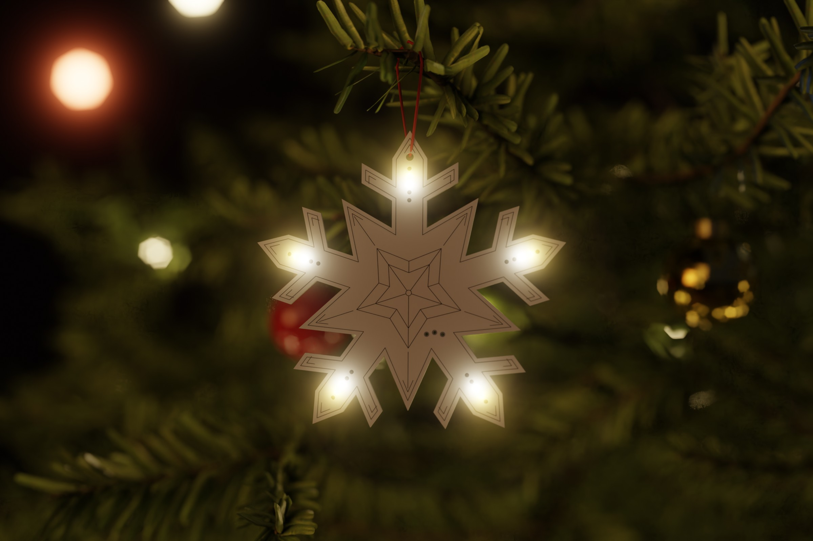
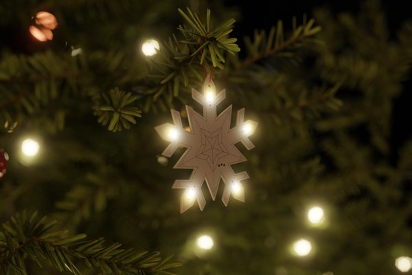

# LEDStars – a snowflake PCB Christmas ornament

**License:** CERN-OHL-S-2.0 · **Author:** Merlin2LmmL

*The ornament hanging from a fir twig by a red string, seen from its back, with the white and yellow LEDs lit. The light shines through the windows in the board. This is a photorealistic Blender render. More colours and camera angles are in the [gallery](#gallery).*

A battery-powered Christmas-tree ornament that *is* its own circuit board: a 5-armed snowflake with 25 LEDs
(5 arms × 5 colours: red, yellow, white, blue, green), a tiny RISC-V microcontroller and a CR2032 coin cell.
Roughly ten of them are meant as gifts, ordered as economic PCBA from JLCPCB.

## The design in short

- **MCU:** WCH CH32V003F4P6 (TSSOP-20, 48 MHz RISC-V)
- **LEDs:** 25 × 1206 *reverse-mount* LEDs (XL-3216), sitting on the front and shining **through** the board, so the
  light comes out of the back as small glowing windows (each LED footprint has a 1.4 mm non-plated window)
- **Matrix:** 5 arms × 5 colours, multiplexed so the 25 LEDs need far fewer pins than LEDs; per-colour series resistors (22–330 Ω)
  compensate for the different forward voltages of red/yellow/white/blue/green
- **Power:** CR2032 in an SMD holder + 100 nF decoupling
- **Controls:** a mode button and a 3-position slide switch (ON / OFF / CLOCK). In the schematic; the PCB routing is still in progress
- **Programming:** three bare SWIO pads (`J1`, 3-pad footprint, no header), meant to be programmed with a WCH-LinkE-style SWIO programmer touching the pads, which saves a connector from the BOM
- **Mechanics:** hang hole at the top arm, outline about 99 × 95 mm (JLCPCB limit: 100 × 100 mm)
- **Status:** hardware design only. No firmware is in this repo yet and no board has been ordered or tested yet.

## Gallery

Pick an LED colour set below, then click a picture for the full 2400 × 1600 image. Each set is shown from three camera angles: **front**, **left** and **right**.

<b>White + yellow</b>

<i>front · left · right</i>

<b>White + blue</b>

<i>front · left · right</i>

<b>Red + green</b>

<i>front · left · right</i>

### How the renders are made

- **Board:** the renders use the KiCad board itself, exported with `kicad-cli pcb export glb`.
- **Tree:** built from the CC0 *Fir Sapling* scans by [Poly Haven](https://polyhaven.com/a/fir_sapling).
- **Physics:** the ornament is not posed by hand. It is a rigid body with real gravity, hanging from a simulated
  string that runs through the hang hole and over a real twig of the tree.
- **Rendering:** Blender 4.5 Cycles at 512 samples with OpenImageDenoise, about 3 minutes per image on an AMD RX 9070 XT.

| File | What |
|---|---|
| [`render/gallery/`](render/gallery/) | all 9 final images, 2400 × 1600 |
| [`LEDStar_hanging_physics.blend`](https://github.com/Merlin2LmmL/LEDStars/releases/latest/download/LEDStar_hanging_physics.blend) | Blender 4.5+ scene (textures packed, 82 MB, download from the [Releases](https://github.com/Merlin2LmmL/LEDStars/releases) page). Press **Play** to watch the ornament drop onto the twig and settle |
| [`render/scene.py`](render/scene.py) | builds the whole scene from the board export |
| [`render/README.md`](render/README.md) | rebuild instructions, options and credits |

## Build journal: how to follow the project

The story of how this board came to be (the ideas, the parts I picked, the things I threw away) is written down as
journal entries in [`JOURNAL.md`](JOURNAL.md).

**How to read it**
- Read it from top to bottom. Entries are in the order I wrote them, so the oldest is first.
- Each entry has a date, a title, a picture and the time I spent on it. The total is in the header at the top of the file.
- A newer entry can overrule an older one, for example when I change a part. Later entries are the current truth.

**Entries so far**

| # | Entry | What it covers |
|---|---|---|
| 1 | [November 17, 2026: Getting the Idea](JOURNAL.md#november-17-2026-getting-the-idea) | Why a snowflake ornament as a gift, and what existing kits looked like |
| 2 | [November 17, 2026 (entry 2): Deciding what the star has to be](JOURNAL.md#november-17-2026-entry-2-deciding-what-the-star-has-to-be) | The requirements: coin cell, no recharging, no through-hole parts, and the first chip (ATtiny404) |
| 3 | [November 17, 2026 (entry 3): Reconsidering my life choises](JOURNAL.md#november-17-2026-entry-3-reconsidering-my-life-choises) | Checking the parts catalogue and switching to the CH32V003 |
| 4 | [November 17, 2026 (entry 4): Deciding on the PCB Outline and LED ordering](JOURNAL.md#november-17-2026-entry-4-deciding-on-the-pcb-outline-and-led-ordering) | The board outline, LED colour order and net classes |
| 5 | [November 17, 2026 (entry 5): Routing the first version](JOURNAL.md#november-17-2026-entry-5-routing-the-first-version) | Placing the parts and routing the first version |
| 6 | [November 17, 2026 (entry 6): Letting the LEDs shine through the board](JOURNAL.md#november-17-2026-entry-6-letting-the-leds-shine-through-the-board) | Reverse-mount LEDs that shine through the board |
| 7 | [November 17, 2026 (entry 7): Reconsidering my life choises ... part 2](JOURNAL.md#november-17-2026-entry-7-reconsidering-my-life-choises--part-2) | Turning the star into a snowflake |
| 8 | [November 17, 2026 (entry 8): Back silkscreen, the repo and JLCPCB being a pain in the ass](JOURNAL.md#november-17-2026-entry-8-back-silkscreen-the-repo-and-jlcpcb-being-a-pain-in-the-ass) | Back silkscreen, the repo, and JLCPCB's Economic assembly saying no |
| 9 | [November 17, 2026 (entry 9): Doing some heavy blender rendering](JOURNAL.md#november-17-2026-entry-9-doing-some-heavy-blender-rendering) | The physics-based Blender renders |

New entries are added to the bottom of `JOURNAL.md` as the project goes on.

## Repository layout

| Path | What |
|---|---|
| `LEDStars.kicad_pro/.kicad_sch/.kicad_pcb` | current KiCad 10 project |
| `LEDStars.kicad_pcb` | the final snowflake board |
| `LEDStars_frontlit_0805.kicad_pcb`, `LEDStars_backlit_1206.kicad_pcb` | earlier board states (see iterations) |
| `lib/` | project symbol, footprint and 3D-model libraries |
| `LEDStar.step` | exported 3D model of the board |
| `docs/` | PDF exports and previews of earlier design states |
| `render/` | photorealistic renders: gallery images, Blender scene and the script that generates it |

## Building it

1. Open `LEDStars.kicad_pro` in KiCad 10.
2. Generate the JLCPCB files (gerbers, BOM, positions) with the *Fabrication Toolkit* plugin. It writes `production/`,
   which is not tracked in git. The LCSC part numbers are stored in the schematic fields.
3. Check the LED rotation in the JLCPCB 3D/placement preview. Reverse-mount parts are the usual source of
   rotation surprises.

## License

[CERN-OHL-S-2.0](LICENSE). If you build on this design, share your changes under the same license.
